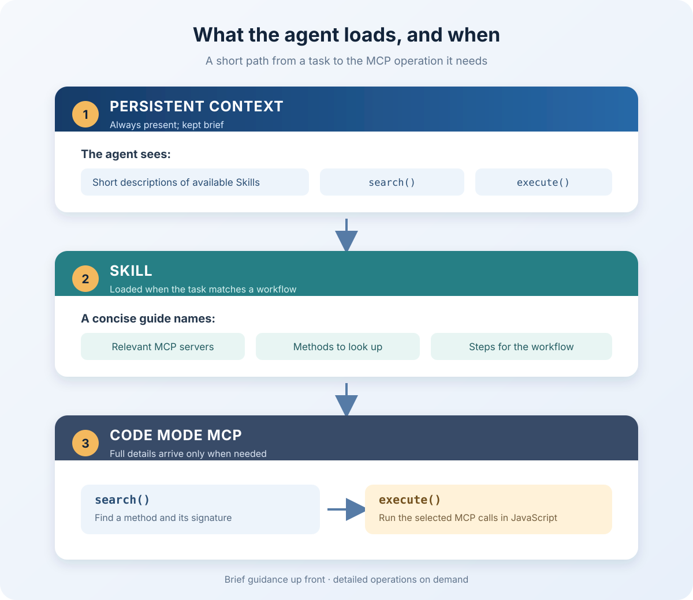

Recently, I was working on two things. One personal, one for work. The personal one was setting up Nanabot, an AI agent that automates the work I do as a programmer. For work, I was writing an MCP server to manage the company's products. And I ran into some problems. When there are a lot of MCP methods, their detailed descriptions really bloat the LLM's context. If you hide them behind Code Mode MCP, the LLM sometimes can't find the MCP method it needs-or doesn't even realize it should look for one.

I learned about Code Mode MCP from a news story about Cloudflare running into a problem with AI agents using up too much context. In the traditional MCP setup, an MCP client can pass the LLM descriptions of all connected tools. Cloudflare has more than 2,500 API methods, and by their estimate, representing all of them as MCP tools would take about 1.17 million tokens. Cloudflare proposed a solution: use Code Mode MCP, which gives the agent just two things instead of thousands of tools: search() and execute().

The first lets you find the API methods you need and get their signatures on request, while the second lets you run JavaScript code that calls those methods. In the implementation they showed, a single execute() call can combine several MCP method calls and return the final result without going back to the LLM between each operation. That can save tokens, but repeated searches and loading signatures also use them. The amount saved depends on the size of the catalog, how often you search, and the number of calls. In my scenario, savings seem likely, but to measure them accurately, you need to test on concrete tasks.

How does this technology work in practice? You tell the AI agent: "Open example.com and take a screenshot of the page." Below is one way to implement an aggregator: search an array of MCP tools, `tools`. This isn't universal Code Mode syntax. For example, Cloudflare's search() looks for operations in an OpenAPI specification. In this aggregator, search could look like this:

```
return tools.filter(t =>
  t.name.includes("navigate") ||
  t.name.includes("screenshot")
);
```

This returns the description:

```
[
  {
    "name": "navigate_page",
    "description":
      "Navigate by URL/history, or reload.\nDefaults to project URL.",
    "inputSchema": {
      "type": "object",
      "properties": {
        "pageId": {
          "type": "number",
          "description": "Targets a specific page by ID."
        },
        "type": {
          "type": "string",
          "enum": ["url", "back", "forward", "reload"],
          "description": "Navigate by URL or history action."
        },
        "url": {
          "type": "string",
          "description": "Target URL (only type=url)."
        },
        "ignoreCache": {
          "type": "boolean",
          "description": "Ignore cache on reload."
        },
        "handleBeforeUnload": {
          "type": "string",
          "enum": ["accept", "dismiss"],
          "description":
            "Accept/dismiss unload dialogs; default is accept."
        },
        "initScript": {
          "type": "string",
          "description": "Run on each document before other scripts."
        },
        "timeout": {
          "type": "integer",
          "description": "Maximum wait in ms; 0 uses the default."
        }
      },
      "required": ["pageId"]
    }
  },
  {
    "name": "take_screenshot",
    "description": "Take a screenshot of the page or element.",
    "inputSchema": {
      "type": "object",
      "properties": {
        "pageId": {
          "type": "number",
          "description": "Targets a specific page by ID."
        },
        "filePath": {
          "type": "string",
          "description":
            "Absolute or relative save path; don't attach it."
        },
        "format": {
          "type": "string",
          "enum": ["png", "jpeg", "webp"],
          "default": "png",
          "description":
            "Format to save as.\nDefault is png."
        },
        "fullPage": {
          "type": "boolean",
          "description": "Capture full page; incompatible with uid."
        },
        "quality": {
          "type": "number",
          "minimum": 0,
          "maximum": 100,
          "description":
            "JPEG/WebP quality 0-100.\nHigher is larger; PNG ignores it."
        },
        "uid": {
          "type": "string",
          "description":
            "Snapshot element UID; omit to capture the page."
        }
      },
      "required": ["pageId"]
    }
  }
]
```
In this implementation, the method description is returned on request rather than necessarily being loaded into context in full. The signature shows that `pageId` is required for both methods. For this example, let's assume the required `pageId` value was obtained beforehand.

Next, execute is called:
```
await chrome_devtools.navigate_page({
  pageId: pageId,
  type: "url",
  url: "https://example.com"
});

const screenshot = await chrome_devtools.take_screenshot({
  pageId: pageId,
  format: "png"
});

return screenshot;
```

Notice that there’s no new request to the LLM between navigate_page and take_screenshot. The Code Mode aggregator runs the next JavaScript statement itself, waiting for the first one to return. I think the benefits are obvious.

Meanwhile, Cloudflare recommends using Skills alongside MCP. Skills explain to the agent when to use Cloudflare’s capabilities and which ones to use. MCP provides access to Cloudflare operations, while Code Mode provides search() and execute() for finding methods and running them through JavaScript.


So I used the same architecture. I hid a large number of MCP methods behind Code Mode. Now the LLM sees just one MCP server that can search for and run MCP methods. But, as I said above, sometimes the AI agent doesn't find the right methods, or doesn't even think to search for them. That's where Skills come in. In their descriptions, I list which MCPs and methods to use. I don't give full descriptions, just brief ones. Here's an example of a Skill that fixes bugs:
```
---
name: bugfix-process
description: >
  Automatically fix bugs by ticket number.
  Use when the user asks to fix a bug,
  task, or error from the ticketing system.
---

# Bugfix Process

## Available MCP servers and methods

### ticket_mcp - ticketing system
- `get_ticket` - get the ticket description.
- `get_comments` - get all comments.
- `list_attachments` - get the list of attachments.
- `download_attachment` - download an attachment.
- `update_status` - change the ticket status.

### samba_mcp - file server
- `list_files` - find files and logs related to the ticket.
- `download_file` - download a file from Samba.

### filesystem_mcp - file system
- `create_directory` - create a directory.
- `write_file` - write a file.
- `read_file` - read a file.

### git_mcp - working with Git
- `current_branch` - get the current branch.
- `stage_files` - add files to the index.
- `commit` - create a commit.
- `show_commit_diff` - get the commit diff.
- `push` - push changes to the remote repository.

### codex_mcp - programming
- `start_task` - start Codex with a prompt.
- `wait_task` - wait for Codex to finish.
- `get_task_result` - get the result of the task.

### jenkins_mcp - project build
- `trigger_build` - start a Jenkins build.

## Bug-fixing process

1. Identify the ticket number, repository, branch, and Jenkins build
   from the user's request.

2. Gather information about the ticket:
   - Get the ticket description and all comments.
   - Download all attachments and related logs from Samba.
   - Save the materials to `tickets/TICKET_NUMBER/` in the selected
     repository.

3. Create a Git commit containing only the contents of
   `tickets/TICKET_NUMBER/`.

4. Start Codex and wait for it to finish. Give it this prompt:

   "Fix the bug described in the files in the tickets/TICKET_NUMBER/
   directory. Review the description, comments, attachments, and logs.
   Fix the cause of the error. Run the necessary tests and report the
   result."

5. Create a separate Git commit with the changes Codex made. Do not
   include unrelated changes.

6. Push the commit with the fix to the remote repository, using the
   current branch unless the user specified a different one.

7. Now the bug fix begins. `codex_mcp` provides the `start_task`,
   `wait_task`, and `get_task_result` methods for this. The agent passes
   Codex the directory path and a prompt for the fix:

   """
   Fix the bug described in the files in the tickets/731/ directory.
   Review the description, comments, attachments, and logs.
   Fix the cause of the error.
   Run the necessary tests and report the result.
   """

   Codex reads the materials at that path, does the work, and returns
   the result. The main agent waits for the task to finish without
   passing the entire ticket and logs through its own context. This way,
   the main agent coordinates the process and delegates the actual
   coding to Codex. If the MCP interface and time limits allow it,
   waiting for Codex and retrieving the result can be combined in a
   single `execute()` call.

8. Once Codex finishes, the agent reviews the DIFF of the changes with
   `show_commit_diff` and checks the result. It then creates a separate
   commit and pushes it to the current branch with `push`. After the
   push succeeds, it starts the Jenkins build `two_jar_java17` using the
   `trigger_build` method from `jenkins_mcp`, so the build checks these
   exact changes.

9. Once Jenkins finishes, the agent evaluates the fix, Codex's tests,
   and the build result. Using `ticket_mcp.update_status`, it sets the
   status to `Resolve` if the bug is fixed, the tests pass, and Jenkins
   finishes successfully. If the fix did not work or the result cannot
   be confirmed, it sets the status to `In Progress`.

10. Based on the final status, the agent prepares a report. For
    `Resolve`, it saves it to `tickets/731/result.fixed.md`, and for `In
    Progress`, to `tickets/731/result.in-progress.md`. The report lists
    the problem, the changes, the results of the Codex and Jenkins
    checks, and any remaining questions. Its contents are checked
    against the commit DIFF and the build result. The report is added in
    a separate commit and pushed to the same branch.

11. In its reply, the agent gives the final filename and includes its
    contents. That way, the user gets more than just a message saying
    "bug fixed"; they get a full report on the work done. The whole
    process, from receiving the ticket to starting the Jenkins build, is
    described in one SKILL, and the necessary MCP methods are chosen as
    the task progresses.
```

**And what did we end up with?**

We split the information an AI agent needs into three levels:

- **Persistent context.** Contains only brief descriptions of available Skills and the two Code Mode tools: `search()` and `execute()`.
- **SKILL.** Loaded when the agent determines it fits the task. Contains the workflow and the names of the necessary MCP servers and methods, but not their full signatures.
- **Code Mode MCP.** In the implementation described, finds full descriptions of specific methods on request and lets you execute a sequence of calls through JavaScript.



That gives us a kind of layered system for discovering and executing tools.

Previously, the agent had two not-so-great options.

The first was to load thousands of tools into context and spend a huge number of tokens on their descriptions.

The second was to hide the tools behind Code Mode and hope the LLM would figure out on its own which methods it needed and how to find them.

With this setup, there's a third option: **SKILL points to what to look for and how to use it, while Code Mode finds the full signatures and executes the operations.**

Of course, this doesn't guarantee success. The LLM can still fail to choose the right SKILL, search for the wrong method, or put the JavaScript together incorrectly. And not every operation can be combined into a single call; sometimes the agent needs to analyze an intermediate result and make a new decision.

With this setup, the agent doesn't need to keep detailed descriptions of all available MCP tools in context. Instead, it gets a brief instruction for a specific workflow and loads the full method details only when it actually needs them.

**In this setup, SKILL is the guide to MCP capabilities, while Code Mode is the mechanism for discovering and executing them.**

In the end, here's the set of SKILLs I ended up with to automate my work as a programmer (the list is, of course, incomplete):

1. Ticket-based bug fixing - gathers the ticket description, comments, attachments, and related logs; coordinates the work on the fix, records the result, and starts a verification build.
2. Ticket implementation - helps take a new feature through the full development cycle: study the requirements and materials, prepare a plan, implement the changes, save the result, and run a build.
3. Working with the ticketing system - opens tickets and shows their descriptions, discussion history, attachments, and key fields.
4. Working with GitLab - helps find projects, browse branches, commits, and files, and carry out routine repository operations.
5. Working with Jenkins - shows available builds, helps start them, and check their status.
6. Working with the file server - finds, downloads, and places files, logs, and materials needed for development and troubleshooting.

I think I'm ready to spend the winter in Thailand. I'll be lying on a sun lounger by the sea or the pool, giving my AI agent orders from my phone. It knows everything now; it can do everything. It knows all the processes, rules, and access permissions.
