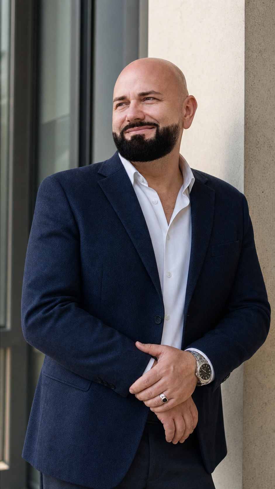

<section class="about-hero">
  

    
About

    <h1>Evgeny Igumnov</h1>
    

      Software developer focused on Rust, AI assistants, document systems,
      backend engineering, and high-load platforms from architecture to production.
    

    

      I'm first and foremost a hands-on software developer. I design and build
      production systems: Rust services, AI runtimes, backend platforms,
      infrastructure, and deployment automation.
    

  

  

    
    

      <strong>Astana, Kazakhstan</strong>
      Software Developer · Rust · AI · Backend
    

  

</section>

<section id="contact" class="about-contact">
  <a href="mailto:igumnovnsk@gmail.com">igumnovnsk@gmail.com</a>
  <a href="https://t.me/ievkz">Telegram @ievkz</a>
  <a href="https://github.com/evgenyigumnov">GitHub @evgenyigumnov</a>
  <a href="https://www.linkedin.com/in/evgeny-igumnov-5121841/">LinkedIn</a>
  <a href="https://habr.com/ru/users/igumnov/articles/">Habr @igumnov</a>
  <a href="https://www.reddit.com/user/ievkz/">Reddit u/ievkz</a>
  <a href="https://www.litres.ru/author/evgeniy-valerevich-igumnov/">Books</a>
  <a href="https://www.instagram.com/secretnsk">Instagram</a>
</section>

<section class="about-stats">
  <article>
    <strong>10M</strong>
    MyLivePage users
  </article>
  <article>
    <strong>20M+</strong>
    page views per day
  </article>
  <article>
    <strong>25+ years</strong>
    software engineering
  </article>
  <article>
    <strong>Rust / AI</strong>
    current technical focus
  </article>
</section>

<section id="selected-work" class="about-section">
  

    
Selected work

    <h2>Products and systems built from architecture through production.</h2>
  

  

    <article class="project-card">
      
Rust / security software

      <h3>Jetico</h3>
      
Security product systems including an adaptive text-classification pipeline in Rust with Candle/CUDA, document search and indexing, and activation licensing.

    </article>
    <article class="project-card">
      
Company / AI platform

      <h3>Relayna</h3>
      
AI assistant platform across desktop, web, cloud, and mobile with a local-first runtime, tool execution, provider integrations, tracing, and production infrastructure.

    </article>
    <article class="project-card">
      
Founder / high-load

      <h3>MyLivePage</h3>
      
Website builder scaled to 10 million users and more than 20 million page views per day.

    </article>
  

</section>

<section class="about-section">
  

    
Community &amp; open source

    <h2>Numbers from developer communities and open-source work.</h2>
  

  

    <article class="social-stats-card">
      <h3><a href="https://www.reddit.com/user/ievkz/">Reddit</a></h3>
      
u/ievkz · on Reddit since Apr 6, 2024

      <ul class="social-metrics">
        <li><strong>1,166</strong>karma</li>
        <li><strong>1,087</strong>post karma</li>
        <li><strong>79</strong>comment karma</li>
        <li><strong>416</strong>contributions</li>
        <li><strong>61</strong>communities</li>
      </ul>
      
Recent communities

      <ul class="community-list">
        <li><a href="https://www.reddit.com/r/ChatGPTCoding/">r/ChatGPTCoding</a></li>
        <li><a href="https://www.reddit.com/r/LocalLLM/">r/LocalLLM</a></li>
        <li><a href="https://www.reddit.com/r/ollama/">r/ollama</a></li>
        <li><a href="https://www.reddit.com/r/LLMDevs/">r/LLMDevs</a></li>
        <li><a href="https://www.reddit.com/r/LLM/">r/LLM</a></li>
        <li><a href="https://www.reddit.com/r/AI_Agents/">r/AI_Agents</a></li>
      </ul>
    </article>

    <article class="social-stats-card">
      <h3><a href="https://habr.com/ru/users/igumnov/articles/">Habr</a></h3>
      
@igumnov · on Habr since 2009

      <ul class="social-metrics">
        <li><strong>87</strong>karma</li>
        <li><strong>145,4</strong>rating</li>
        <li><strong>108</strong>followers</li>
        <li><strong>42</strong>articles</li>
        <li><strong>292</strong>comments</li>
        <li><strong>128K+</strong>reach in 30 days</li>
      </ul>
    </article>

    <article class="social-stats-card">
      <h3><a href="https://github.com/evgenyigumnov">GitHub</a></h3>
      
@evgenyigumnov · on GitHub since 2015

      <ul class="social-metrics">
        <li><strong>7</strong>public repositories</li>
        <li><strong>222</strong>stars total</li>
        <li><strong>91</strong>followers</li>
      </ul>
      
Top repositories

      <ul class="repository-list">
        <li>rustsn<strong>75 stars</strong></li>
        <li>cblt<strong>72 stars</strong></li>
        <li>candle-simplified-example<strong>40 stars</strong></li>
        <li>blueprint4llm<strong>22 stars</strong></li>
      </ul>
    </article>
  

</section>

<section class="about-section">
  

    
Current focus

    <h2>Hands-on software engineering, from design to production.</h2>
  

  

    <article>
      <h3>Software engineering</h3>
      
Builds and ships Rust, backend, AI, document, and infrastructure systems.

    </article>
    <article>
      <h3>Principal Developer</h3>
      
Designing and shipping Rust, backend, document, AI tooling, and infrastructure systems.

    </article>
    <article>
      <h3>High-load experience</h3>
      
Scaled MyLivePage to millions of users with practical performance engineering and operations.

    </article>
  

</section>

<section class="about-section">
  

    
Experience

    <h2>Built products, platforms, and production systems.</h2>
  

  

    <article>
      

        <strong>Jetico, Finland</strong>
        September 2020 - Present
      

      

        <h3>Principal Rust Developer</h3>
        
Work in an AI-assisted development workflow using Codex and Claude Code while maintaining production-level quality standards.

        
Implemented an adaptive open-set text-classification training pipeline in Rust using Candle/CUDA with threshold calibration, reproducible JSON bundles, and evaluation tooling.

        
Developed document search/indexing systems and activation license services using Rust, Actix, Tokio, SeaORM, SQLite, Diesel, and MySQL.

      

    </article>

    <article>
      

        <strong>Relayna Inc, USA</strong>
        March 2026 - October 2026
      

      

        <h3>Founder / Executive Lead / Software Developer</h3>
        
Founded <a href="https://relayna.com">Relayna</a> and remained hands-on building its agentic AI assistant platform for desktop, web, cloud, and mobile.

        
Architected an AI runtime that turns model responses into multi-step workflows, with support for multiple LLM providers and both local and cloud configurations.

        
Built AI workflows across email, documents, web browsing, browser automation, files, and productivity integrations. Implemented semantic document search, vision-powered image understanding, and local speech transcription.

        
Designed safeguards for tool execution, permissions, and real-world actions. Developed the product across desktop, cloud runtime, backend, web, and mobile, and managed its production infrastructure.

      

    </article>

    <article>
      

        <strong>Jetico, Finland</strong>
        September 2014 - August 2020
      

      

        <h3>Principal Java / Scala / Angular Developer</h3>
        
Built and maintained enterprise systems including Jetico Central Manager, TotalWipeOut server, Jetico Messenger server, and License Generator.

        
Worked with Scala, Java, TypeScript, Spring, Hibernate, Akka, Slick, Angular, Docker, and Kubernetes.

      

    </article>

    <article>
      

        <strong>MyLivePage, USA</strong>
        January 2007 - August 2014
      

      

        <h3>Founder / Senior PHP Developer / High-load Expert</h3>
        
Managed and built the company departments, developed the core CMS, and optimized the platform for high-load environments.

        
Scaled the website builder to 10 million users and more than 20 million page views per day using Linux, PHP, Lighttpd, MySQL, and Memcached.

      

    </article>

    <article>
      

        <strong>Geocad, Russia</strong>
        February 2001 - December 2006
      

      

        <h3>Principal Java Developer</h3>
        
Worked on backend development, database structure design, performance tuning, and technical architecture.

      

    </article>

    <article>
      

        <strong>Le Petit Fute, France</strong>
        September 1996 - January 2001
      

      

        <h3>Perl Developer</h3>
        
Developed websites and designed database structures.

      

    </article>
  

</section>

<section class="about-section education-card">
  
Education

  <h2>Master of Computer Science</h2>
  
Novosibirsk State Technical University, Faculty of Automation and Computer Engineering, Software Development. 1996-2002.

</section>
